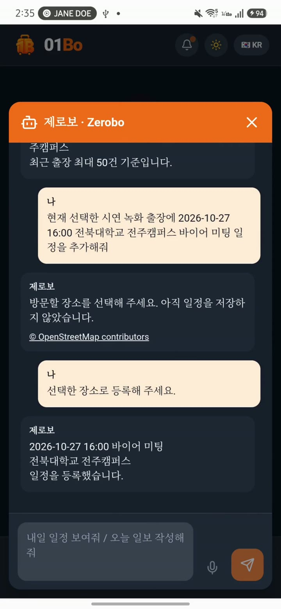
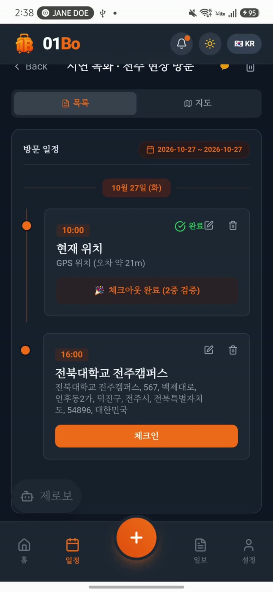
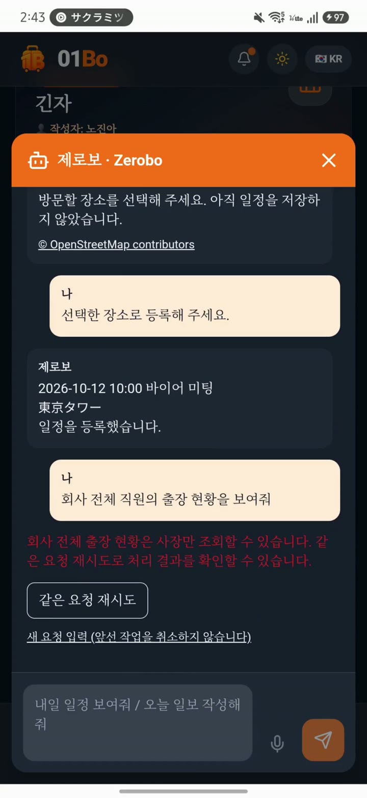
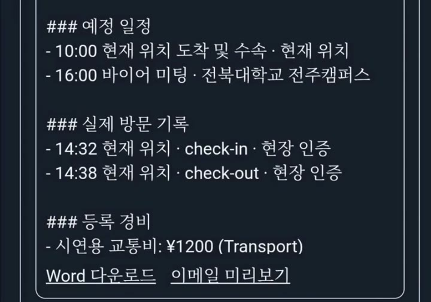
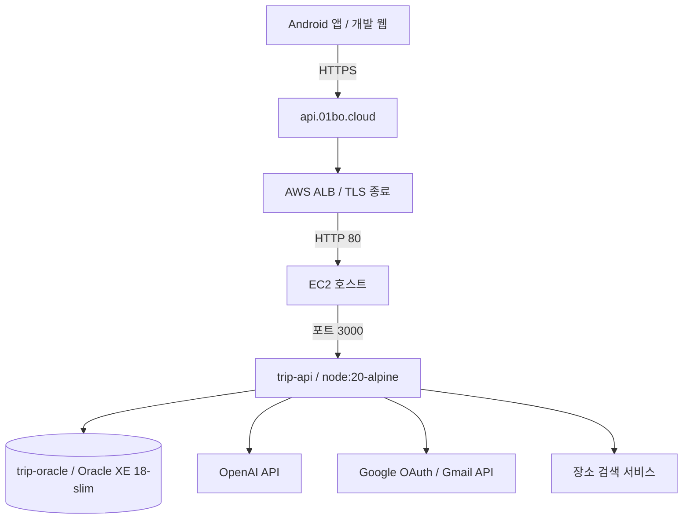
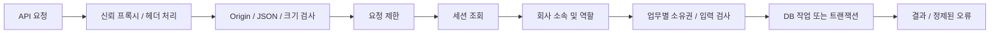
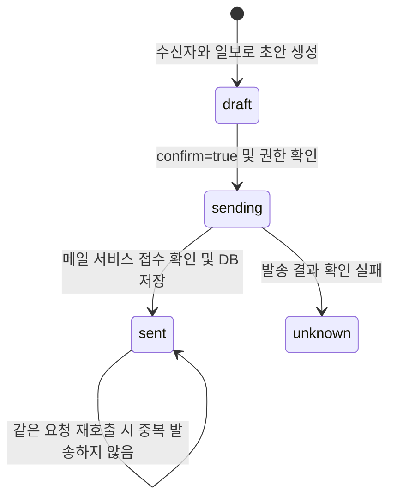
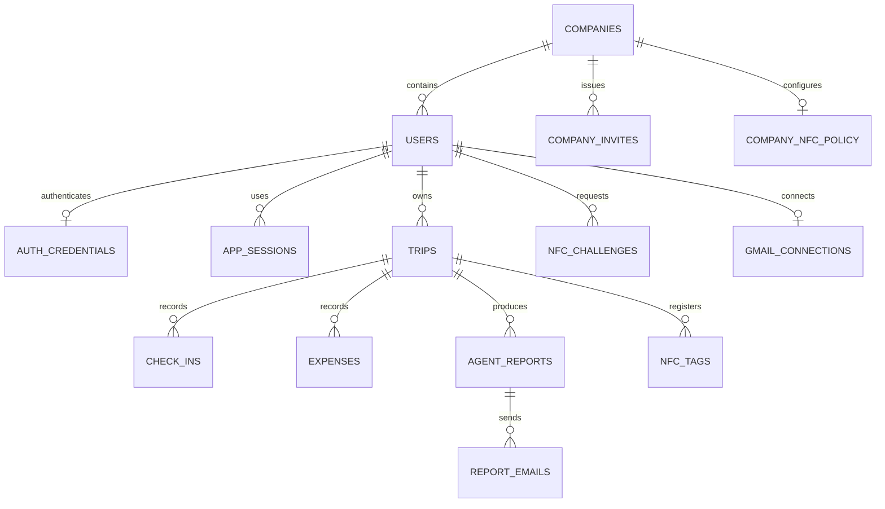

> **2026-11-12 제출 보강:** [보안·성능 변경과 검증 범위](docs/SUBMISSION_SECURITY_20261112.md). 앱 v0.321 / 코드 8. 아래 v0.32 영상은 이전 시연 증거입니다. 새 소스의 운영 적용·실기기 검증과 구분하세요.

# 01BO Server

**출장 일정·현장 방문·경비·제로보·일보·Gmail을 연결하는 Express + Oracle 백엔드입니다.**

[Android/프런트엔드 저장소](https://github.com/hangjin01/01BO) · [운영 소스 반영 기록](docs/SERVER_SYNC_20261101.md) · [시연 증거](docs/DEMO_GUIDE.md) · [원본 파일 해시](docs/server-source-sha256-20261101.json)

> 문서 기준 **2026-11-02**, 운영 소스 수집 **2026-11-01**, 실기기 시연 **2026-10-27**. 이 저장소에는 실행 중인 AWS 컨테이너의 백엔드 코드가 반영되어 있습니다. 소스 업로드와 재배포는 별개이며, 문서 작성 중 서버 재시작·DB 변경·메일 발송을 하지 않았습니다. 제품 버전은 개발·시연용 v0.32이고 정식 출시는 v1.0입니다.

## 목차

- [이 서버가 하는 일](#이-서버가-하는-일)
- [앱에서 확인한 결과](#앱에서-확인한-결과)
- [현재 운영 구조](#현재-운영-구조)
- [요청 처리와 권한](#요청-처리와-권한)
- [제로보 작업 처리](#제로보-작업-처리)
- [NFC와 GPS 검증](#nfc와-gps-검증)
- [일보와 이메일 처리](#일보와-이메일-처리)
- [데이터 구조](#데이터-구조)
- [API 안내](#api-안내)
- [환경변수](#환경변수)
- [개발 실행과 배포 준비](#개발-실행과-배포-준비)
- [테스트](#테스트)
- [장애 확인 순서](#장애-확인-순서)
- [소스 탐색](#소스-탐색)
- [남은 문제와 운영 한계](#남은-문제와-운영-한계)

## 이 서버가 하는 일

직원이 앱에서 일정을 저장하면 서버는 로그인 사용자의 회사와 소유권을 확인하고 Oracle에 기록합니다. 사장은 자기 회사 직원의 출장 기록을 조회할 수 있습니다. 제로보가 자연어를 이해하더라도, 실제 저장·조회·발송 권한은 서버에서 다시 확인합니다.

| 업무 | 서버의 책임 |
| --- | --- |
| 가입·로그인 | 비밀번호 검증, 세션 발급·만료·로그아웃 |
| 회사 생성·직원 초대 | 소속·역할 부여, 초대 코드 만료/사용 처리 |
| 출장·일정 | 기간·좌표·입력 검증, 소유자 기준 쓰기 |
| 방문 인증 | GPS/NFC 규칙 확인, 체크인/아웃 순서와 중복 검증 |
| 경비 | 본인 출장에 금액·날짜·분류 저장 |
| 제로보 | 허용된 작업 해석, 권한 검사, 작업 결과 저장 |
| 일보 | 저장된 일정·방문·경비로 날짜별 내용 구성 |
| Word·메일 | 문서 생성, 수신자 확인, 명시적 발송 승인, 결과 상태 저장 |
| 운영 상태 | 프로세스 liveness와 DB readiness 구분 |

일반적인 AI 채팅 프록시만 있는 서버가 아닙니다. 사용자별 업무 상태, 회사 접근 범위, 외부 서비스 호출과 중복 방지가 함께 들어 있습니다. 반대로 범용 자율 에이전트나 임의 SQL 실행 도구를 제공하는 서버도 아닙니다.

## 앱에서 확인한 결과

아래는 서버와 연결한 Samsung SM-S916N의 실제 시연 영상에서 추출한 화면입니다. UI 자체는 프런트엔드 저장소가 담당합니다.

| 제로보 일정 생성 | NFC+GPS 현장 확인 | 직원 권한 제한 |
| :---: | :---: | :---: |
|  |  |  |
| 05:45 · 실제 저장 결과 | 08:30 · 체크아웃 이중 검증 | 12:35 · AI 요청에도 서버 권한 적용 |



**10:10 일보 화면 발췌.** 예정 일정, 실제 방문 시각, 등록 경비 및 Word 다운로드가 표시됩니다. 당시 메일 오류 UI와 개인 이메일 영역은 이 발췌 범위에 포함하지 않았습니다. 이후 Gmail을 재연결했고 영상 마지막 14:20에 실제 수신과 Word 첨부가 확인됩니다.

실기기 시연은 GPS 체크인 → NFC+GPS 체크아웃 순서였습니다. 음성 인식과 실제 영수증 OCR은 이번 영상에서 성공을 검증하지 않았습니다. 캡처는 테스트 전체를 대신하지 않으며, [시연 가이드](docs/DEMO_GUIDE.md)에 확인 범위를 기록했습니다.

## 현재 운영 구조



| 항목 | 확인된 구성 |
| --- | --- |
| API 도메인 | `https://api.01bo.cloud/api` |
| 2026-11-01 SSH 주소 | `57.183.24.179` — 변경될 수 있는 운영 기록 |
| 실행 API 컨테이너 | `trip-api`, `node:20-alpine` |
| 실행 코드 마운트 | `/home/ubuntu/japan-trip-app/backend` → `/app` |
| API 포트 | 호스트 80 → 컨테이너 3000 |
| DB 컨테이너 | `trip-oracle`, `gvenzl/oracle-xe:18-slim` |
| DB 접근 | node-oracledb 연결 풀; 기본 `db:1521/XEPDB1` |
| 수집 범위 | 코드/설정 템플릿/테스트 51개 파일, SHA-256 기록 |

운영 DB를 RDS로 설명하지 않습니다. 서버의 `/home/ubuntu/01BO_Server` 폴더는 실행 컨테이너의 실제 마운트가 아니었습니다. 이번 소스는 **실제 마운트 경로**에서 가져왔습니다. 환경 파일, 토큰, DB 덤프와 과거 백업은 GitHub에 복사하지 않았습니다.

`docker-compose.yaml`과 `backend/Dockerfile`은 초기 저장소 구성입니다. 현재 운영 설정 전체를 복제한 파일이 아니므로 아래 [배포 준비](#개발-실행과-배포-준비)를 먼저 읽으세요.

## 요청 처리와 권한



### 로그인과 세션

- 이메일을 로그인 ID로 사용하고 비밀번호는 15~128자로 검사합니다.
- 비밀번호는 scrypt 해시로 저장합니다. 원문 저장 구조가 아닙니다.
- 세션 원문은 32바이트 무작위 값이며 DB에는 해시를 저장합니다. 만료는 8시간입니다.
- 웹은 `o1bo_session` HttpOnly/Secure/SameSite=Lax 쿠키, 경로 `/api`를 사용합니다.
- 네이티브 로그인은 `sessionMode: "native"`로 토큰을 받고 이후 `Authorization: Bearer ...`를 사용합니다. 프런트의 보안 저장소가 이를 관리합니다.
- 잘못된 로그인 5회 이후 계정은 10분 잠금 처리됩니다. IP 기준 로그인/가입 제한도 별도로 있습니다.
- 신규 계정은 회사 없는 `employee`로 시작합니다. 계정 생성만으로 사장 권한이 생기지 않습니다.
- Gmail OAuth는 메일 발송 연결입니다. 앱 로그인용 Google SSO와 동일한 기능이 아닙니다.

### 회사 및 역할

| 상황 | 실제 정책 |
| --- | --- |
| 회사 없는 사용자의 회사 생성 | 서버 생성 회사 코드, 생성 계정을 `admin`으로 지정 |
| 직원 참여 | 서버 발급 초대 코드 확인, 같은 트랜잭션에서 소속 변경·초대 소비 |
| 초대 코드 | 기본 24시간, 원문 대신 해시 저장, 사용/취소/만료 처리 |
| 기존 회사 소속 사용자 | 임의 회사 변경 거부; 기존 기록은 원래 회사 유지 |
| 직원 출장 조회 | 본인 + 같은 회사 조건 |
| 사장 출장 조회 | 같은 회사의 다른 직원도 조회 가능 |
| 출장 수정/삭제 | 소유자 기준; 사장의 조회 권한이 임의 수정 권한을 의미하지 않음 |
| 매니저 | 일부 팀 생성 가능; 사장 전체 조회 권한과 다름 |
| 회사 코드 위조 | 요청 값만으로 소속·역할을 부여하지 않음 |

세션 조회에서 현재 회사가 활성 상태인지 확인합니다. 일부 쓰기 경로는 사용자 또는 출장 행을 잠그고 현재 소속을 다시 확인합니다. 다만 이 설명은 코드의 구현 규칙이며 독립적인 보안 감사 완료나 모든 공격 차단 보장을 뜻하지 않습니다.

### 입력·프록시·오류

`TRUSTED_PROXY_CIDRS`에 지정한 실제 프록시만 신뢰하도록 구성하고, 클라이언트의 `X-Forwarded-Host`는 제거합니다. 외부 로그인에는 HTTPS가 필요합니다. CORS Origin 목록은 명시적으로 관리합니다. 본문 제한은 현재 15MB이며 업무 API 요청 제한도 적용합니다.

오류는 일반적으로 `{ "success": false, "message": "..." }` 형태입니다. 모든 성공 API가 같은 wrapper를 쓰는 것은 아닙니다. 프런트는 해당 API의 반환 구조에 맞춰 처리해야 합니다. 일반적인 서버 오류는 DB 내부 상세를 그대로 반환하지 않습니다.

## 제로보 작업 처리

프런트에서 들어온 요청은 로그인 사용자의 범위 안에서 처리됩니다. 공급자는 Responses 또는 설정된 관리형 에이전트 어댑터를 사용할 수 있습니다. 관리형 설정 파일은 비공개 경로에 두며 Git에 포함하지 않습니다.

| 작업 | 의미 |
| --- | --- |
| `clarify` | 정보가 부족하거나 지원하지 않는 요청 안내 |
| `list_trips` | 본인 또는 허용된 회사 범위 조회 |
| `create_event` | 장소 후보 선택을 거쳐 방문 일정 추가 |
| `update_event` | 대상 일정의 지원 필드 변경 |
| `write_report` | 출장/날짜의 실제 저장 기록으로 일보 생성 |
| `send_report` | 이메일 초안 생성과 발송 확인 흐름 연결 |

스키마 필드는 `action`, `question`, `tripId`, `itemId`, `date`, `time`, `title`, `location`, `scope`, `recipient`로 제한됩니다. AI가 반환한 작업을 실행하기 전에 서버가 입력·권한을 확인합니다. 요청 ID와 결과 기록은 중복 요청 처리에 사용합니다.

AI에 전달되는 정보는 요청 처리에 필요한 메시지와 조회 범위의 출장 정보 등을 포함할 수 있습니다. 개인정보·출장 데이터의 외부 처리 범위는 서비스 운영자가 사용자에게 고지해야 합니다. API 키는 서버 환경에만 보관합니다.

`config/zerobo-agent.json`은 서버에서 수집한 모델 설정입니다. 파일이 있다는 사실이 해당 모델의 현재 제공 여부나 결제 상태를 보증하지 않습니다. 이번 문서 작업에서 실제 유료 모델 호출은 하지 않았습니다.

## NFC와 GPS 검증

회사 정책과 해당 일정의 태그 등록 여부를 함께 확인합니다. 회사 정책이 켜져 있어도 활성 태그가 없는 일정까지 무조건 NFC 필수로 만들지는 않습니다.

1. 사장이 해당 회사의 출장·일정에 태그를 등록합니다.
2. 직원이 본인 방문 일정의 체크인/체크아웃을 요청합니다.
3. 서버가 사용자·회사·출장·일정·동작에 묶인 챌린지를 발급합니다.
4. 앱이 태그를 읽고 최신 위치와 정확도, 측정 시각을 전송합니다.
5. 서버가 등록 태그·거리·정확도·유효기간을 검사합니다.
6. 기록 저장과 챌린지 소비를 같은 트랜잭션에서 수행합니다.

| 항목 | 검사 내용 |
| --- | --- |
| 태그 | 원문 대신 해시 비교, 같은 회사/출장/일정의 활성 등록 |
| 거리 | 목적지 50m 이내 |
| GPS 정확도 | 유한한 0~50m 값 |
| 위치 시각 | 서버 시각과 차이 60초 이내 |
| 챌린지 | 유효기간 내, 해당 사용자와 동작에 일치, 한 번만 소비 |
| 결과 | `nfc_gps`, `gps`, `unverified` 저장 |

태그 없는 GPS 방식은 `near` 여부에 따라 인증/미인증을 구분합니다. NFC가 필수인 일정에서 태그 누락 또는 수동 값으로 우회하면 거부합니다. 정적 NFC 태그의 암호학적 진위 증명과 GPS 위조 방지는 별개 문제입니다. 고정 현장 태그를 사용해야 하며, 개인이 들고 다니는 스티커를 방문 증거로 해석하면 안 됩니다.

## 일보와 이메일 처리

### 일보는 어떤 데이터로 만들어지나요?

`lib/agent/reports.js`는 해당 사용자의 출장 일정, 그 날짜의 방문 기록, 등록 경비를 조합합니다. 없는 회의 성과를 모델에게 만들어 쓰도록 요청하지 않습니다. 날짜 처리에는 `Asia/Tokyo`를 사용하고 현재 비용 표기는 JPY 중심입니다. 일반적인 세계 각국 시간대·통화 정산이 완성된 것으로 설명하지 않습니다.

Word는 서버에서 생성하며 인증된 다운로드 경로로 제공합니다. 보고서 소유자·회사 조건을 확인하고 파일을 반환합니다.

### Gmail 연결

앱의 연결 요청 → 서버의 단기 launch ticket → Google 동의 → 서버 callback → 암호화 토큰 저장 순서입니다. PKCE와 일회성 state, 쿠키 일치 검사를 사용하고 Google에서 허용된 이메일을 확인합니다. 콜백 중 회사가 변경되면 연결을 거부합니다.

운영 승인 리디렉션 URI는 `https://api.01bo.cloud/api/gmail/callback`입니다. Google Cloud의 웹 OAuth 클라이언트에 같은 URI가 있어야 합니다. 저장 토큰은 `O1BO_TOKEN_KEY`로 암호화하며 키를 임의로 재생성하면 기존 연결을 해독할 수 없습니다.

### 발송 상태



- `draft`: 발송 전 미리보기입니다.
- `sending`: 외부 발송 단계로 들어간 상태입니다. 이 상태에서 재호출해 자동 중복 발송하지 않습니다.
- `sent`: 메일 서비스 접수입니다. 수신함 도착을 보장하는 상태는 아닙니다.
- `unknown`: 타임아웃 등의 이유로 결과 확인이 필요합니다. 보낸편지함과 수신 여부를 확인해야 합니다.

`confirm: true` 없는 발송 요청은 거부합니다. 수신자 형식을 검사하며 사용자별 발송 제한도 적용합니다. 외부 서비스가 접수한 뒤 DB 갱신이 실패하면 `sending`이 남을 수 있고, 이 경우에도 자동 재발송을 막습니다. 시연의 마지막 메일은 사용자가 실제 수신과 Word 첨부를 확인했습니다.

## 데이터 구조



이 그림은 핵심 관계를 설명하는 개념도입니다. 모든 컬럼·외래키·제약조건을 열거한 물리 스키마는 아닙니다.

| 테이블/그룹 | 저장하는 정보 |
| --- | --- |
| `COMPANIES`, `USERS` | 회사 상태, 소속·역할·프로필 |
| `TRIPS` | 출장 기간·목적·일정 JSON·보고 내용 |
| `CHECK_INS` | 방문 시각·유형·현장 검증 방법 |
| `EXPENSES` | 날짜·내용·분류·금액 |
| `AUTH_CREDENTIALS` | 로그인 ID·해시·실패 횟수·잠금 |
| `APP_SESSIONS`, `LOGIN_CODES` | 세션과 기존 일회용 로그인 코드 해시/만료 |
| `APP_TEAMS`, `COMPANY_INVITES` | 팀 및 회사 참여 코드 |
| `AGENT_REQUESTS`, `AGENT_REPORTS` | 요청 중복 처리 기록·일보 |
| `GMAIL_CONNECTIONS`, `GMAIL_OAUTH_STATES` | 암호화 연결 토큰·OAuth 진행 상태 |
| `REPORT_EMAILS` | 수신자·본문·첨부 대상·발송 상태 |
| `NFC_TAGS`, `NFC_CHALLENGES`, `COMPANY_NFC_POLICY` | 태그 연결·일회성 확인·정책 |
| `APP_SERVICE_LIMITS` | 여러 API 작업자가 공유하는 장소 검색 요청 제한 |

기본 SQL은 `oracle-init/`, 추가 테이블은 `backend/scripts/migrate*.js`에 있습니다. 이미 존재하는 테이블을 건너뛰는 코드가 완전한 스키마 버전 관리 도구를 의미하지는 않습니다. 백업·현재 스키마·적용 이력을 확인한 후 별도 테스트 DB에서 검증해야 합니다.

## API 안내

운영 base URL은 `https://api.01bo.cloud/api`입니다. 아래 표에서 `/health`를 제외한 경로는 `/api` 뒤에 붙입니다. 별도 표시가 없는 업무 API는 로그인 및 회사 소속이 필요합니다.

### 상태·인증·회사

| Method | 경로 | 역할 |
| --- | --- | --- |
| GET | `/health` — API prefix 없음 | 인증·DB 쿼리 없는 liveness |
| GET | `/health` — API prefix 있음 | DB `SELECT 1` readiness |
| POST | `/auth/register` | 계정 생성; `name`, `email`, `password`, 선택 `sessionMode` |
| POST | `/auth/login` | 비밀번호 로그인 |
| GET | `/auth/me` | 현재 세션 사용자 |
| POST | `/auth/logout` | 세션 폐기 |
| POST | `/auth/exchange` | 기존 일회용 코드 교환 경로 |
| PATCH | `/users/me` | 본인 이름 변경; 현재 사용자 조회는 `/auth/me` |
| GET | `/users`, `/users/:actorUid` | 본인/사장 범위의 사용자 조회 |
| GET / POST | `/companies` | 소속 회사 조회 / 회사 생성 |
| GET / POST | `/companies/:code/invites` | 사장 초대 목록 / 발급 |
| DELETE | `/companies/:code/invites/:id` | 초대 취소 |
| POST | `/companies/invites/preview`, `/companies/join` | 초대 확인 / 참여 |
| POST | `/teams`, `/teams/join` | 허용된 팀 생성 / 참여 |

`/users/me`의 프로필 변경은 PATCH만 문서화된 작업입니다. GET `/users/:actorUid`에 `me`라는 임의 ID를 보내는 방식과 혼동하지 마세요.

### 출장·방문·경비

| Method | 경로 | 역할 |
| --- | --- | --- |
| GET / POST | `/trips` | 허용된 출장 조회 / 본인 출장 생성 |
| GET / PUT / DELETE | `/trips/:id` | 상세 / 본인 수정 / 본인 삭제 |
| GET | `/trips/:id/summary` | 조회 범위 내 방문·경비 요약 |
| GET / POST | `/check-ins` | 방문 목록 / 체크인·체크아웃 |
| GET / POST | `/expenses` | 경비 목록 / 등록 |
| DELETE | `/expenses/:id` | 본인 경비 삭제 |
| GET | `/exchange-rate?jpy=1200` | 설정 환율에 따른 KRW 환산; 실시간 시장 환율 아님 |
| POST | `/trips/:id/report/email` | 기존 출장 보고서 이메일 경로; 상세는 실행 코드 확인 |

### 제로보·일보·Gmail·NFC

| Method | 경로 | 역할 |
| --- | --- | --- |
| GET | `/agent/status`, `/agent/history` | 기능 연결 상태 / 대화 기록 |
| POST | `/agent/messages` | 제로보 요청 |
| GET | `/agent/report-options` | 일보 대상 본인 출장 |
| GET / POST | `/agent/reports` | 일보 목록 / 생성 |
| GET | `/agent/reports/:id/docx` | 인증된 Word 다운로드 |
| POST | `/agent/reports/:id/email-preview` | 수신자 지정 초안 |
| GET | `/agent/emails` | 본인 발송 상태 목록 |
| POST | `/agent/emails/:id/send` | `confirm: true`로 최종 발송 |
| GET | `/gmail/status` | Gmail 연결 상태 |
| POST | `/gmail/connect` | Gmail 연결 시작 |
| DELETE | `/gmail/connection` | Gmail 연결 해제 |
| GET | `/gmail/launch`, `/gmail/callback` | 공개 OAuth 진입·콜백; 상태 검증 적용 |
| GET / PUT | `/nfc/policy` | 회사 정책 조회 / 사장 변경 |
| GET | `/nfc/requirement` | 일정별 NFC 필요 여부 |
| GET / POST | `/nfc/tags` | 사장 태그 목록 / 등록 |
| DELETE | `/nfc/tags/:id` | 정책 조건에 따른 등록 해제 |
| POST | `/nfc/challenge` | 본인 일정의 일회성 확인 발급 |
| POST | `/ai/generate` | 기존 AI 생성 호환 경로 |

이 표는 API 탐색 안내입니다. 필수 body·응답은 연결된 실행 코드와 테스트를 확인하세요. 오래된 [API_SPECIFICATION.md](API_SPECIFICATION.md)의 인증 없는 예시를 현재 계약으로 사용하면 안 됩니다.

읽기 전용 상태 확인 예:

```bash
curl --fail https://api.01bo.cloud/health
curl --fail https://api.01bo.cloud/api/health
```

liveness 예시는 `{"success":true,"message":"OK"}`, readiness 성공에는 `"database":"ready"`가 포함됩니다. `/`의 404만으로 API 장애라고 판단하지 않습니다. 프로세스 최초 시작은 DB 풀 초기화 후 listen하므로, DB가 전혀 준비되지 않으면 `/health` 자체가 열리기 전일 수 있습니다.

## 환경변수

운영 비밀값은 Git에 넣지 않습니다. 코드가 `.env`를 자동 읽는 구조가 아니므로 실행 환경 또는 지원되는 Node의 `--env-file` 기능으로 주입해야 합니다.

| 변수 | 목적 / 주의 |
| --- | --- |
| `PORT` | 기본 3000 |
| `DB_USER`, `DB_PASSWORD`, `DB_CONNECT_STRING` | Oracle 연결; 비밀번호 필수 |
| `ALLOWED_ORIGINS` | 쉼표 구분 Origin; PC/네이티브 앱/배포 웹에 맞춰 지정 |
| `TRUSTED_PROXY_CIDRS` | 실제 ALB/프록시 대역만 신뢰; 전체 대역 허용 금지 |
| `JPY_KRW_RATE` | 환산 설정값, 기본 9.15; 실시간 API 아님 |
| `OPENAI_API_KEY`, `OPENAI_MODEL` | 서버 AI 연결 및 모델 |
| `O1BO_AGENT_MODE` | `responses` 지정 시 관리형 어댑터 대신 Responses 사용 |
| `O1BO_AGENT_ID_FILE` | 관리형 에이전트 비공개 ID 파일 경로 |
| `O1BO_GOOGLE_CLIENT_ID`, `O1BO_GOOGLE_CLIENT_SECRET` | Google 웹 OAuth 클라이언트 |
| `O1BO_GOOGLE_REDIRECT_URI` | 승인된 정확한 callback URI |
| `O1BO_TOKEN_KEY` | 32바이트 키의 base64; 기존 연결 암호화 키 보존 |
| `O1BO_GEOCODER_URL`, `O1BO_GEOCODER_USER_AGENT` | HTTPS 검색 공급자와 식별 User-Agent |

장소 검색 구현은 한국·일본을 대상으로 최대 5개 결과를 요청합니다. 캐시와 DB 공유 제한을 적용하며 신규 요청 슬롯은 1.2초 간격입니다. 외부 공급자 정책 준수와 운영 계약은 별도로 관리해야 합니다. 검색어/좌표가 외부에 전달되는 흐름을 고려하세요.

`.env.example`은 초기 DB 중심 템플릿입니다. 위 전체 기능 변수를 모두 포함하지 않으며 DB_POOL_MIN/MAX처럼 실제 코드에서 사용하지 않는 과거 항목도 있습니다. 설정 이름의 최종 기준은 실행 코드입니다.

## 개발 실행과 배포 준비

### 개발 서버

```bash
git clone https://github.com/hangjin01/01BO_Server.git
cd 01BO_Server/backend
npm ci
# Node가 --env-file을 지원하고, 별도 테스트 환경 파일과 Oracle 스키마가 준비된 경우:
node --env-file=/absolute/path/to/private-test.env server.js
```

운영 이미지는 Node 20 계열이며 이번 로컬 검사에는 Node 24를 사용했습니다. Oracle DB와 테이블이 준비되어야 시작됩니다. 테스트 DB 비밀번호, Gmail 키, 사용자 토큰은 명령줄 인수나 터미널 출력에 직접 남기지 마세요. `npm test`는 현재 기본 실패 스크립트이므로 아래 개별 테스트 명령을 사용합니다.

### DB 구성과 마이그레이션

`oracle-init/`은 기초 스키마이고 `migrate_multitenancy.js`, `scripts/migrate.js`, `migrate-workflow.js`, `migrate-nfc.js`가 추가 구성을 담당합니다. 정확한 순서와 기존 컬럼 호환성은 현재 DB와 비교해야 하며, 이 문서는 새 DB에서 전체 자동 설치가 검증됐다고 주장하지 않습니다.

운영 DB에서 시드나 통합 테스트를 무심코 실행하지 마세요. 여러 테스트는 임시 사용자·회사·출장을 생성/삭제하고 기존 시연 계정을 요구하기도 합니다. 읽기 전용 테스트라고 가정하면 안 됩니다.

### 기존 Docker 파일의 범위

| 파일/설정 | 현재 주의점 |
| --- | --- |
| `docker-compose.yaml` | 초기 예제; 운영 비밀 환경과 AI/Gmail 전달을 재현하지 않음 |
| 예제 DB 암호 기본값 | 실제 배포 전에 제거하고 비공개 환경에서 필수 주입 |
| `1521:1521` | DB 포트 외부 노출을 제한하고 보안 그룹/바인딩 확인 |
| `privileged: true` | 필요한 권한인지 재검토 |
| `npm install` 시작 명령 | 잠금 파일 재현성과 배포 방식 별도 정비 |
| `backend/Dockerfile` | Git에 없는 `instantclient.rpm`을 요구하는 과거 빌드 |
| 실제 운영 | `node:20-alpine`와 소스 바인드 마운트 |

운영 적용 전 백업과 복구 경로, 스키마 호환성, 정확한 프록시/CORS/OAuth 설정을 준비합니다. 이번 소스 반영에서는 컨테이너 재시작이나 자동 배포를 실행하지 않았습니다.

## 테스트

다음은 외부 AI·Google·운영 DB를 사용하지 않는 검사입니다. 프록시 검사는 로컬 포트를 엽니다.

```bash
cd backend
node tests/unit.js
node tests/gmail.js
node tests/openai.js
node tests/managed-agent.js
node tests/proxy.js
```

| 테스트 | 확인 내용 |
| --- | --- |
| `unit.js` | 날짜·좌표·금액·일정 입력 경계 |
| `gmail.js` | 토큰 암호화/변조 거부, PKCE, state, 재사용·소속 변경 거부 |
| `openai.js` | 요청 스키마, 오류·거절·불완전 응답, 지원하지 않는 작업 |
| `managed-agent.js` | 관리형 세션, 허용 도구, 중복 완료·오류 처리 |
| `proxy.js` | 신뢰 프록시 HTTPS, Host 위조 방어, 네이티브 preflight/CORS |

2026-11-01에 위 5개 검사와 JavaScript 45개 파일 구문 검사가 통과했습니다. 51개 수집 파일의 내용도 원본과 대조했습니다. 이 문서 작성에서는 실제 결제 API, 메일 발송, 마이그레이션, APK 테스트를 다시 실행하지 않았습니다.

`integration.js`, `agent.js`, `nfc.js`, `membership.js`, `password-auth.js`, `workflow.js` 등은 실행 전 소스를 읽고 테스트 DB를 지정해야 합니다. `managed-live.js`는 실제 외부 연결을 사용하는 검사이므로 모의 검사 목록에 포함하지 않습니다.

## 장애 확인 순서

| 증상 | 확인 순서 |
| --- | --- |
| 도메인 연결 실패 | DNS → 인증서/ALB → Target 상태 → EC2 보안 그룹 → 컨테이너 포트 |
| `/health` 실패 | 컨테이너 상태/시작 로그; 시작 시 DB 준비를 기다리는지도 확인 |
| `/health` 정상, `/api/health` 503 | Oracle 준비 상태, 연결 문자열/계정, 세션/풀 |
| 외부 로그인 403 | TLS 전달, 신뢰 프록시 범위, Origin과 실제 HTTPS |
| 로그인 401 | 계정/비밀번호, 잠금, 세션 만료, 회사 활성 상태 |
| 회사 기록이 안 보임 | 현재 계정의 소속/역할; 다른 회사 또는 직원 전체 조회는 제한 |
| Gmail callback 400 | Google 승인 URI와 서버 URI 일치, state/쿠키, 로그인 중 소속 변경 |
| Gmail `invalid_grant` | 사용자 재연결, 기존 암호화 키 보존 여부 |
| 메일 `sending`/`unknown` | 자동 재발송 금지; Google 보낸편지함/수신 여부와 DB 상태 대조 |
| 검색 429/502/503 | DB 요청 슬롯, 공급자 설정/응답/캐시/네트워크 |
| NFC 409/422 | 챌린지 만료·중복, 위치 시각/정확도, 등록된 일정·태그 일치 |
| AI 실패 | 연결 설정, 모델/사용량, 허용 도구·스키마 오류; 메시지에 비밀값 노출 금지 |

EC2 주소가 바뀌면 SSH 대상과 인프라 연결을 확인합니다. 앱의 API 도메인을 매번 임시 IP로 되돌리는 방식은 사용하지 않습니다.

## 소스 탐색

| 경로 | 읽어야 하는 이유 |
| --- | --- |
| `backend/server.js` | 실제 라우트 장착 순서·상태 확인·미들웨어 |
| `backend/db.js` | 풀 준비, 연결, 트랜잭션·재시도 범위 |
| `backend/lib/auth.js`, `password*.js` | 로그인/세션·해시·잠금 |
| `backend/routes/application.js` | 현재 회사·출장·방문·경비 업무 라우트 |
| `backend/routes/workflow.js` | 일보·파일·메일·Gmail 상태 |
| `backend/routes/nfc.js`, `lib/nfc.js` | 정책·등록·챌린지·검증 |
| `backend/lib/agent/` | 제로보 공급자·작업·일보 |
| `backend/lib/gmail.js`, `mail.js` | OAuth와 암호화, 발송 상태 머신 |
| `backend/lib/report-docx.js` | Word 생성 |
| `backend/lib/places.js` | 검색 제한·캐시·공급자 요청 |
| `backend/config/` | 지침과 모델 설정 |
| `backend/scripts/` | 마이그레이션·운영 보조 |
| `backend/tests/` | 모의 검사와 DB/외부 통합 검사 |
| `docs/` | 출처·검증·시연 캡처 |

`routes/trips.js`, `companies.js`, `users.js` 등 과거 분리 파일도 남아 있습니다. 파일이 존재한다고 모두 현재 서버에서 장착되는 것은 아닙니다. `server.js`에서 실제로 require하는 라우트를 기준으로 판단하세요.

## 남은 문제와 운영 한계

### 의존성

2026-11-01 잠금 파일의 npm audit 결과는 4건입니다. 운영 원본을 보존하기 위해 소스 수집 PR에서는 패키지를 변경하지 않았습니다.

| 패키지 | 심각도 | 후속 검증 |
| --- | --- | --- |
| `proxy-addr` | critical | IP/신뢰 프록시 관련 패치 후 프록시 회귀 |
| `body-parser` | high | 압축 본문 DoS 관련 패치 |
| `nodemailer` | moderate | 주소 파싱/SMTP 패치 후 수신자·전송 검사 |
| `qs` | moderate | 파싱·직렬화 패치 후 입력 검사 |

### 제품·운영

- 관리자 통계가 실제 방문/경비를 반영하지 못하는 화면 문제와 메일 상태 복원 문제는 남아 있습니다.
- 초기 README/API 명세의 모든 예시가 현재 계약과 일치하지 않아 최신 실행 경로를 이 문서에 정리했습니다.
- 정적 NFC와 클라이언트 GPS만으로 복제·위조를 완전히 막을 수 없습니다.
- 일부 요청 제한/캐시는 프로세스 메모리에 있으므로 다중 인스턴스 배포 시 동작 범위를 재검토해야 합니다.
- 비밀번호 재설정·이메일 소유 확인·운영자용 계정 복구의 전체 절차가 이 문서에서 검증된 것은 아닙니다.
- DB 백업/복구, 비밀값 교체, 배포/롤백과 모니터링을 포함한 운영 절차는 추가 정비가 필요합니다.

프런트엔드에는 이전 로컬 백엔드 사본이 남아 있지만, 앞으로 서버 코드 검토는 이 저장소를 기준으로 진행합니다. README와 PR에 실제 비밀번호, 세션/Google 토큰, API 키, 활성 초대 코드를 기록하지 않습니다.
